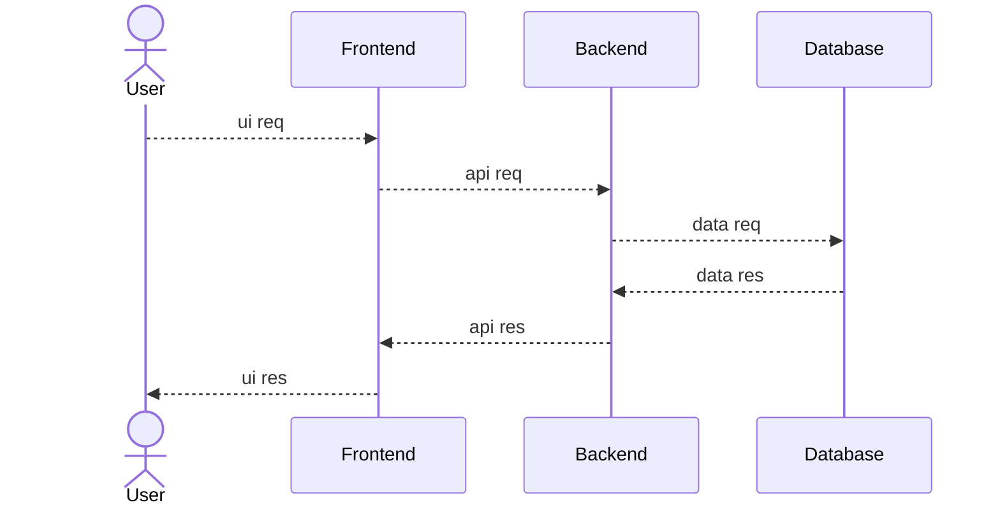
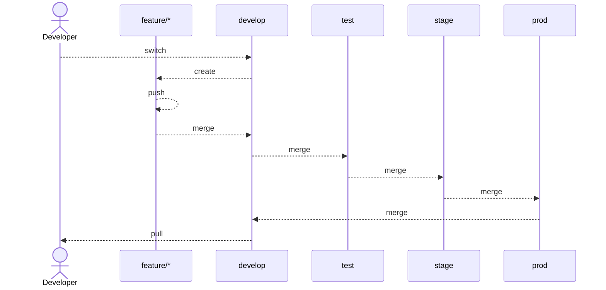

# POC #01 - Node & React Setup

## Agile Management Board
- Link: [Github Project Board](https://github.com/users/OfficialApurvChatur/projects/18)

## System Architecture

### 01. High Level Design (HLD)

### 02. Low Level Design (LLD)

#### 01.01. Git Branching & PR Strategies Setup LLD

#### 01.02. Project Overview Setup LLD
#### 01.03. Environmnet Setup LLD
#### 01.04. Playwright Setup LLD
#### 01.05. Servers & DNS Setup LLD
#### 01.06. CI/CD Deployment Setup LLD 

## Servers & DNS
